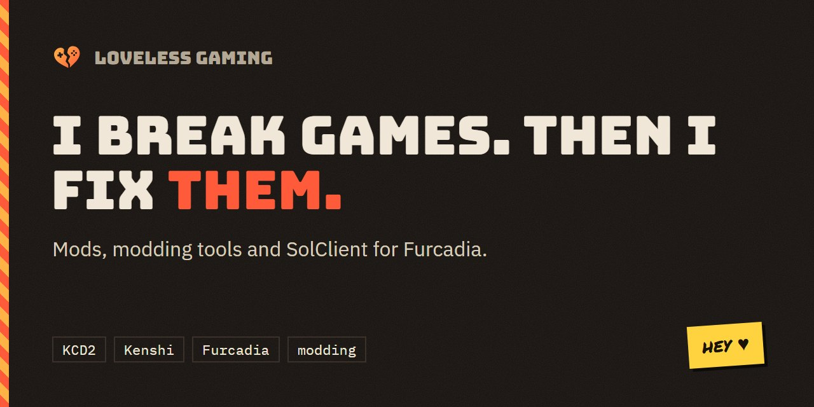

Hey, I'm ResurexXxion, the person behind **[Loveless Gaming](https://lovelessgaming.com)**.

I play heavily modded games, and when they fall over I build the tools to put them back together. Everything here started as a fix for my own setup, so it's all tested on real, messy installs.

### Stuff I've made

| | |
|---|---|
| **[Loveless Mod Consoles](https://github.com/ResurexXxion/loveless-mod-consoles)** | Live log consoles and plain-English crash post-mortems for modded KCD2, Kenshi and Mass Effect LE. |
| **[Loveless Mod Fixes](https://github.com/ResurexXxion/loveless-mod-fixes)** | Configs, key layouts and a merge builder that stops KCD2 mods overwriting each other. |
| **[SolClient](https://lovelessgaming.com/solclient/)** | A modern add-on for the Furcadia client, with a DragonSpeak studio and map editor. In development ([changelog](https://github.com/ResurexXxion/solclient/blob/main/CHANGELOG.md)). |
| **[lovelessgaming.com](https://github.com/ResurexXxion/lovelessgaming.com)** | My site's source: plain Node, no frameworks. |

### Find me

[Website](https://lovelessgaming.com) · [Discord](https://discord.gg/qcmgVa2Fx6) · [YouTube](https://www.youtube.com/@lovelesskuno) · [Twitch](https://www.twitch.tv/resurexxxion) · [Nexus Mods](https://www.nexusmods.com/profile/ResurexXxion) · [Ko-fi](https://ko-fi.com/lovelessgaming)

Everything I make is free. Bug reports and ideas are always welcome, here or in the Discord.
